# Using kowalski

kowalski records your workday as you switch between tasks. Each stretch of
work on a task becomes a timed interval. The dashboard reports the day, says
when you can clock out, and posts hours to a ticketing system when a
provider is attached.

The daemon serves the dashboard at `http://127.0.0.1:47100/`. Opening
`kowalski.exe` starts it and opens the dashboard in your browser (a switch
in Settings turns the browser part off); `kowalski open` does the same from
a terminal. `kowalski start` and `kowalski autostart on` (start at logon)
run it quietly. The dashboard can be installed as an app from the browser.

Every screenshot here shows made-up data (see
[Making these screenshots](#making-these-screenshots)).

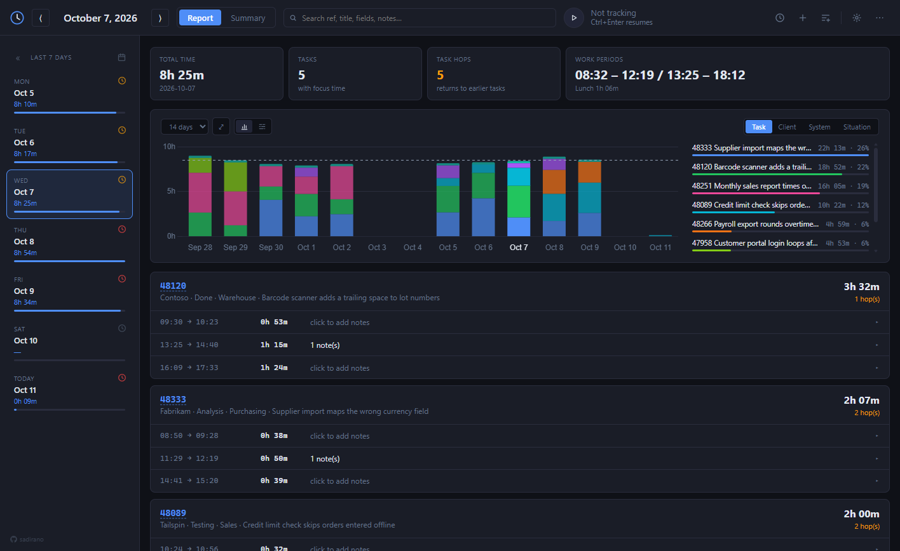

## The guided tour

The tour is the real dashboard running on a sample database, so everything
you click really works, but nothing touches your own data. Start it from
**Take the tour** in the ⋯ menu; on an empty tracker it is offered once.

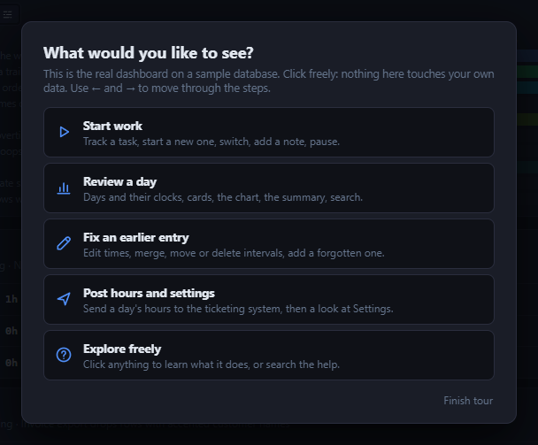

Each tour starts fresh: four weeks of made-up history in your language,
work earlier today that ended a few minutes ago, an example ticketing
provider that answers on the machine, and your own settings, so the
dashboard looks like yours. Pick what you want to see:

- **Start work:** play, a new task, switching, notes, pausing.
- **Review a day:** the day list and its clocks, the cards, the chart, the
  summary and search.
- **Fix an earlier entry:** editing times, merging, moving and deleting
  intervals, adding a forgotten one.
- **Post hours and settings:** sending a day's hours, then a walk through
  Settings.
- **Explore freely:** help mode on the whole page.

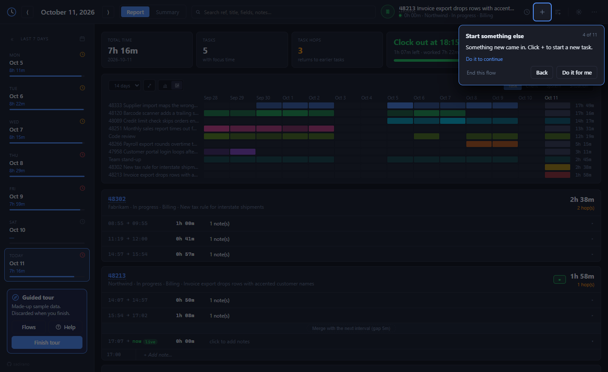

A step highlights one control and says what it is for. When it asks you to
do something it waits; it never moves on by itself. Done before it asked?
It says so. `→` (or **Next**) moves on and `←` goes back; on a step you have
not done, `→` and **Do it for me** do it for you first, so the next steps
find what they expect. A window you open on the way (Settings, a note)
lifts the dimming, and the step comes back when you close it.

The tour's panel sits under the day list: a reminder that the data is
made up, **Flows** to pick again, **Help**, and **Finish tour**, which
deletes the sample database and brings back your dashboard. With the
sidebar collapsed it moves to a bar at the bottom of the window.

Features that need a ticketing provider are marked as such; in the tour the
example provider stands in for yours.

### Help mode

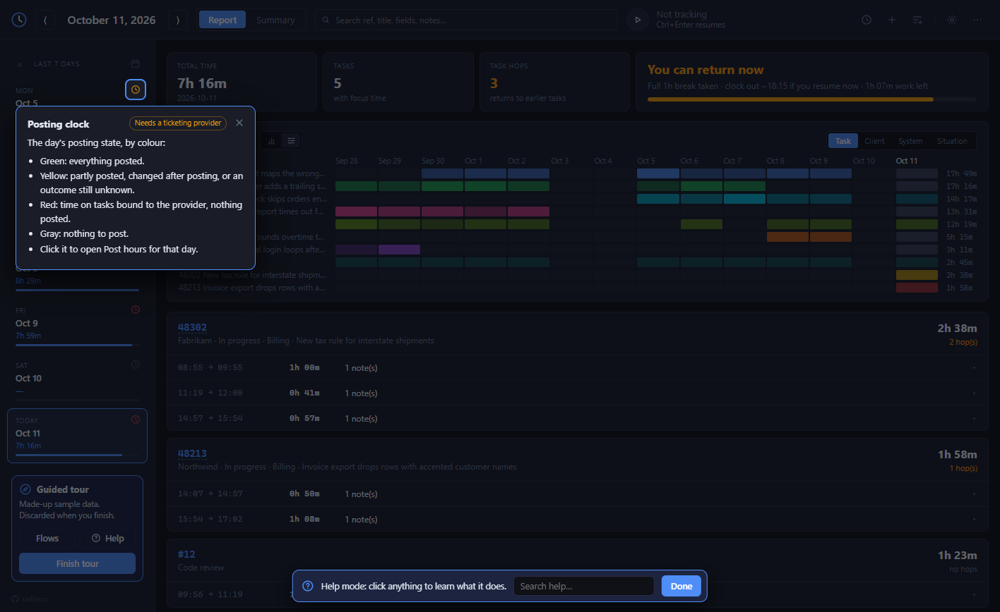

**Help: click to explain** in the ⋯ menu (or Help in the tour) turns
clicks into explanations: point at anything and click to see what it is,
how to use it and what to watch out for, with its shortcut. The search box
finds a topic by name in your language. `Escape` or **Done** leaves help
mode. The **?** in each dialog and settings section opens the help for
that spot, in or out of the tour.

## The command bar

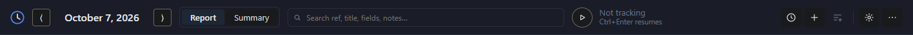

One bar across the top holds everything you use all day, from left to right:

- **Date and arrows:** the day being shown. The arrows step one day; `←` and
  `→` do the same, and `T` jumps to today.
- **Report / Summary:** the two views of a day (`1` and `2`).
- **Search:** finds a task by ref, title, provider field or note text
  (`Ctrl+K` or `/`).
- **Current task:** the round button starts, pauses and resumes tracking
  (`Ctrl+Enter`). Beside it are the task's ref and title, then the elapsed
  time and the task's fields. When nothing is running it says so, and what
  `Ctrl+Enter` will do.
- **Post hours** (clock), **new task** (`+` or `N`), and
  optionally **add entry** and **keyboard shortcuts**, both switched on in
  Settings.
- **Settings** (`Ctrl+,`) and the **⋯ menu**.

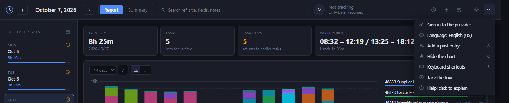

The menu holds the rest: signing in to the provider, the language (English,
Portuguese or Japanese), adding a past entry (`A`), hiding the chart (`C`),
the shortcut list (`?`), the [guided tour](#the-guided-tour) and
[help mode](#help-mode).

## Tracking

Start a task with **new task**: type a title and press Start. With a
provider you can type the task's ref instead, and the provider fills in the
title and fields (click the magnifier to look it up again). Starting a task
closes the interval of the one you were on, so there is always one focus.

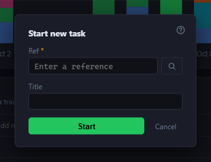

To go back to an earlier task, press its ▶ in the report or in a search
result. Pause closes whatever is open and remembers it; resume brings it
back.

**Parallel work.** A task can run next to the focus (`kowalski parallel
<task>`), for a build or a call you keep an eye on. Parallel time is shown
with a badge and never added to totals, hops, charts or posting. See
[parallel-tasks.md](parallel-tasks.md).

**Screen lock, sleep and shutdown.** Locking the screen inside the windows
set in Settings pauses tracking, so lunch is not counted by accident. Sleep,
hibernate, shutdown and stopping the daemon end tracking at any hour; press
play to pick the task up again.

## Days

The sidebar lists recent days (7 by default), each with its total, a
progress bar toward the daily target, and a clock icon for its posting
state:

| Clock | Meaning |
|---|---|
| green | everything is posted |
| yellow | partly posted, changed after posting, or an outcome still unknown |
| red | time on bound tasks, nothing posted |
| gray | nothing to post |

The clock opens Post hours for that day. `[` collapses the sidebar.

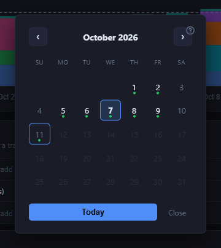

The calendar (`G`, or the icon above the list) opens any day; a dot marks a
day with time.

## Cards

Four cards head the report:

- **Total time:** focus time for the day.
- **Tasks:** tasks with focus time that day.
- **Task hops:** switches back to a task already worked on that day.
- **Work periods:** start, lunch out, lunch back and end. Your lunch is the
  day's longest pause of at least half the minimum break.

For today, the last card turns into the schedule: when you can clock out,
how much is left, and after lunch the earliest return that keeps a full
break.

Paid breaks come from the provider (or from Settings): short pauses inside
those windows count toward the daily target, up to the allowance, but never
toward a task's posted hours.

## The report

Each task worked on that day gets a card, biggest first: ref, provider
fields, title, total and hops. Under it, one row per interval.

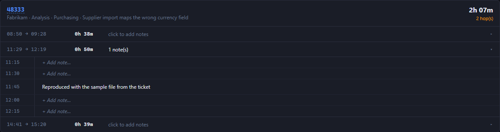

- **Notes:** click a row to open its 15-minute slots, then click a slot to
  write a note there. Notes can be edited and deleted.
- **Edit times:** the pencil changes an interval's start and end. Times are
  typed (`930`, `9:30`, `5pm` all work) and shown in your 12- or 24-hour
  format.
- **Merge:** adjacent intervals of the same task and role merge with the
  button between them.
- **Move:** drag an interval, or slots selected with click and Shift+click,
  onto another task's card.
- **Delete:** the bin removes an interval that is not running.

Edits never overlap two focus intervals and are refused if the interval
changed meanwhile. A posted day can still be edited: its clock turns yellow,
"changed after posting".

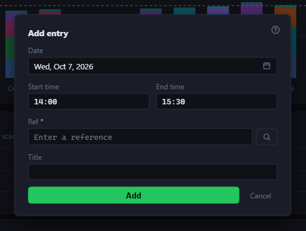

**Add entry** (`A`) records time you forgot to track: pick the day on the
same calendar, type the start and end, and the ref or title.

## The chart

The chart covers the last 7 to 90 days, grouped by task or by a provider
field. The tabs on the right switch the grouping; Settings can hide the
fields you never group by.

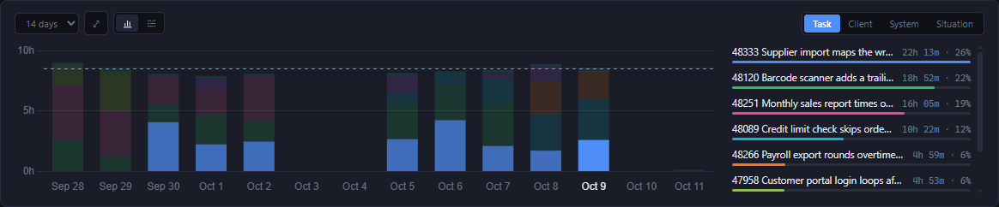

Beside it, every series is ranked by its time in the range. Pointing at a
row highlights its bars, and clicking it hides or shows that series. A
click on a column opens that day. The expand button makes the chart taller.

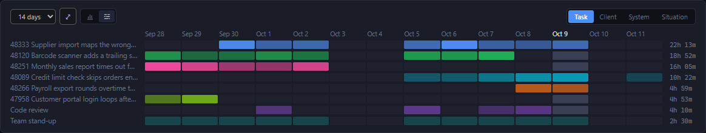

The second view, **task lanes**, gives each series a row and each day a
cell, which reads better when many tasks share the range.

## Summary

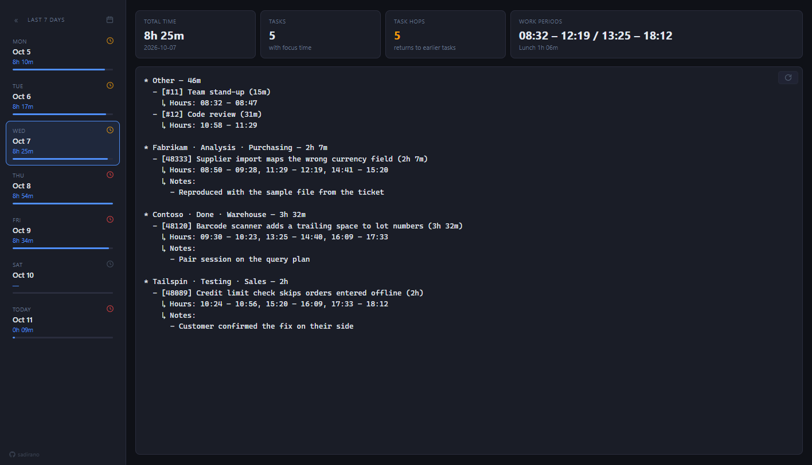

The Summary tab writes the day out as text, grouped by provider fields or
in time order (Settings > Summary format), with each task's hours and notes.
Edit it freely; it saves as you type. The button at the top right
regenerates it from the day's data.

## Search

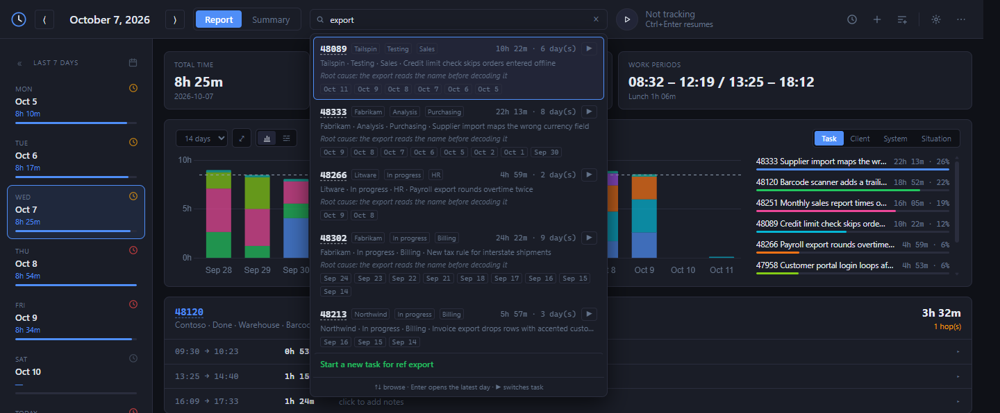

Search matches refs, titles, provider fields and notes. Each result shows
the task's time, the days it was worked on (click one to open it) and a ▶
to switch to it. `↑` and `↓` browse, `Enter` opens the latest day. The
last row starts a new task with what you typed.

## Updates

To check for a newer kowalski release, run `kowalski update` or use
**Settings > Advanced > Check for updates**. Kowalski contacts GitHub only
when you ask. Unsigned releases are refused. To install a signed ZIP without
network access, put its `.sig` beside it and run `kowalski update --from
<absolute path to ZIP>`. The filename must be
`kowalski-vX.Y.Z-windows-x86_64.zip`.

After signature checks, kowalski swaps the executables and starts the previous
daemon as an update guard. The guard snapshots the database only after the old
daemon stops, then starts the candidate. It waits for readiness and a stable
10-second period before committing. If the candidate fails, the guard restores
both executables and the database snapshot and restarts the previous version.
Sessions, notes, day summaries and posted hours from before the update remain.
`update.json` beside the database records the transaction and its result; an
interrupted update is finished on the next launch. The Settings update row and
`kowalski update` report the result once. After a committed update, the
`.old` executables, staging files and snapshot are removed on a later normal
start, when the guard has exited.

## Attaching a provider

Drop one provider DLL directly in the `providers` folder next to the
database, then run `kowalski provider` to see its full SHA-256, file size,
and version claims. Compare the SHA-256 with the hash its publisher gives
you and run `kowalski provider trust <sha256>`. If you choose to trust the
file as it is without that comparison, run `kowalski provider trust
--current`. Both commands require the daemon to be running.

When you drop in a new version, kowalski keeps using the last approved
version while the new one waits for approval. After approving it, use
`kowalski restart` or the **Restart now** button in Settings to load it.
This catches a DLL changed by accident or without you noticing; it does
not protect against software already running as your Windows user.

## Post hours

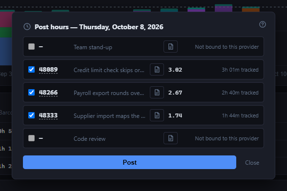

Post hours lists each task with time that day. For tasks bound to the
provider it shows the amount still left to post, as the provider quotes
it (never a typed one), and what was already posted. Tick the rows and press
Post; each post creates a new entry in the external system. The page icon
adds a posting note, filled from the day's notes when that option is on. A
posting whose outcome is unknown is never retried on its own: check the
external system, then mark it posted or not posted. A provider may add
options to each row, such as booking it another way; `kowalski post -o
<name>` sets them from the CLI.

If the provider supports it, turn on **Post each session with its start and
end** in Posting settings to create one entry for each closed focus session.
The dialog shows remaining local time ranges; a running session waits until
it stops. Already posted ranges are kept covered so later edits offer only
new time. A day already posted as a total stays in total mode for that ref.

Signing in to the provider is in the ⋯ menu, or `kowalski provider login` (the daemon must be running).

## Settings

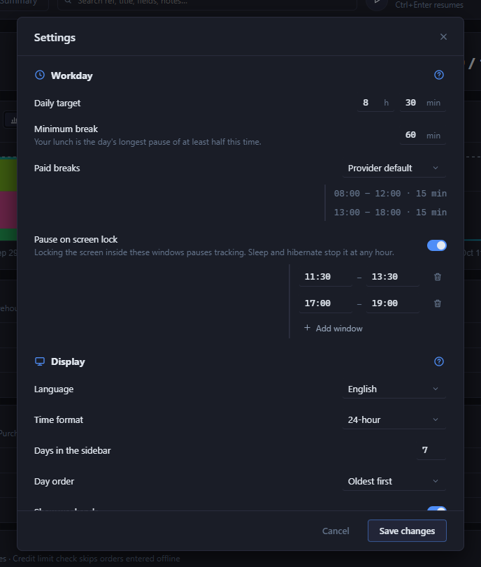

**Workday**

- **Daily target** and **minimum break:** what the schedule counts toward.
- **Paid breaks:** the provider's windows, your own, or none.
- **Pause on screen lock:** the windows in which locking pauses tracking.

**Display**

- Language, 12- or 24-hour time, days in the sidebar, day order, weekends.
- Task order within a day: most time first, by task ID, or in the order
  they were first worked on that day.
- Which optional buttons the command bar shows (add entry, shortcuts).
- Chart tabs: the provider fields offered as chart groupings.
- Summary format, and whether refs link to the provider's page.

**Posting**

- Filling posting notes from the day's notes, any settings the provider
  adds (`kowalski set provider.<name> <value>` from the CLI), and the
  provider account.

**Advanced**

- The reporting time zone (a Windows zone name) and **Day starts at**
  (`00:00` to `12:00`, default `00:00`): work before that time belongs to the
  previous day, everywhere, past days included. Hours already posted keep
  the day they were posted on.
- The HTTP port, which is changed with `kowalski set
  http_port <n>`.
- **Restart kowalski** stops and starts the background service.

## Keyboard shortcuts

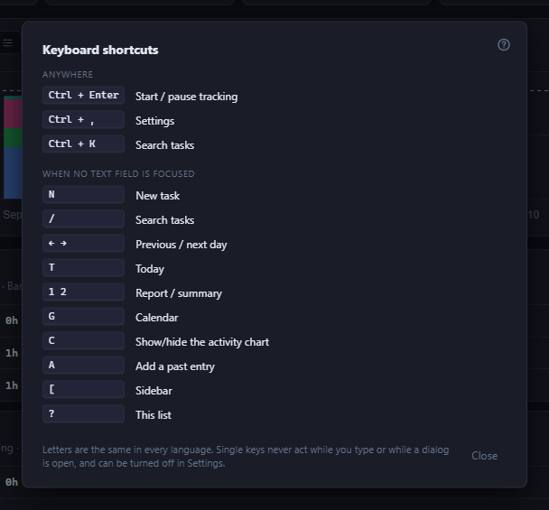

| Keys | Action |
|---|---|
| `Ctrl+Enter` | start / pause tracking |
| `N` | new task |
| `Ctrl+,` | settings |
| `Ctrl+K`, `/` | search |
| `←` `→` | previous / next day |
| `T` | today |
| `1` `2` | report / summary |
| `G` | calendar |
| `C` | show or hide the chart |
| `A` | add a past entry |
| `[` | sidebar |
| `?` | the shortcut list |

Keys are the same in every language and follow the character your layout
types. Single-key shortcuts never act while you type in a field, while a
dialog is open or while Japanese input is composing, and **Single-key
shortcuts** in Settings turns them off. In a tour flow, `←` and `→` step
through the flow instead of the days.

## The command line

Everything the dashboard does is also a command; `kowalski --help` lists
them. Some examples:

```
kowalski switch 48213 -m "picked up the export bug"
kowalski parallel "Code review"
kowalski note "waiting on the client"
kowalski day 2026-10-07
kowalski post 2026-10-07 48213
```

A task is `#<id>`, an external ref, or a title.

## Making these screenshots

The screenshots come from `kowalski demo`, which fills an empty database
with four weeks of made-up tasks, notes, summaries and postings, in English,
Portuguese or Japanese. The guided tour uses the same history; its
screenshots come from a tour started on that database.

```
kowalski --db <scratch>/kowalski.db demo --lang en --at 2026-10-11T18:30 --port 47101
kowalski --db <scratch>/kowalski.db start
```

Only one daemon runs per user, so stop your own first. `demo` refuses a
database that already has tasks. Its tasks are bound to the selected
provider (or `example`) with the fields Client, System and Situation; a
provider that declares those fields shows them.
